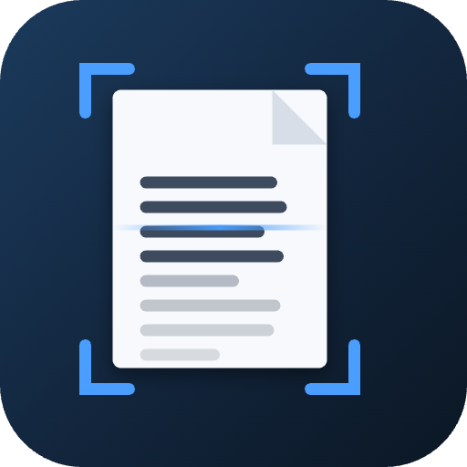

# OmniOCR

Offline, structure-preserving OCR for documents that arrive in bad condition —
faint, blurred, low-resolution, skewed, photographed at an angle, stained,
speckled or smudged — without losing anything on clean ones.



## What makes it different

**It adapts to the damage.** Every page is profiled first (sharpness, noise,
ink/paper contrast, illumination, glyph size, skew, foreign-mark load). That
profile decides how the page is restored, how many ways it is recognised, and how
much effort it earns. Clean pages finish in one pass; damaged pages escalate
until the result stops improving.

**It recognises each page several ways and fuses the results.** One restoration
recovers faint strokes but fuses characters; another separates characters but
drops light ones. OmniOCR runs several and votes — per line, and per word —
so the output contains text that no single pass read correctly.

**It refuses to invent text.** On speckled or stained pages OCR engines
confidently emit text where there is none. OmniOCR rejects lines that are
simultaneously low-confidence, non-lexical and structurally implausible. On a
badly damaged test page this alone took the character error rate from 89.8 % to
8.9 %.

**It keeps the document's structure.** Output is rebuilt from a layout model —
headings, paragraphs, reading order, columns, lists, tables, running heads — not
emitted as a flat character stream. Tables come out as tables in Word, HTML and
CSV.

**It never re-recognises a born-digital PDF.** If a PDF already has a real text
layer, that text is used exactly, and the effort goes into structure instead.

**It can use your phone's depth camera.** When a photo carries a depth or
disparity map (iPhone Portrait/LiDAR captures, Android Dynamic Depth), OmniOCR
uses it to segment the page from a cluttered background and flatten page curl.

## Install

Download the installer for your platform from
[Releases](../../releases), or build it yourself:

```bash
npm install
npm run dist:mac     # → dist/OmniOCR-1.0.0-arm64.dmg
npm run dist:win     # → dist/OmniOCR Setup 1.0.0.exe  (cross-builds from macOS too)
```

Builds are unsigned. On macOS, right-click the app → **Open** on first launch.

## Use

1. **Add documents** (or drop them on the window) — PDF, JPG, PNG, TIFF, HEIC, WEBP, BMP.
2. Pick an effort level: *Fast* for clean scans, *Balanced* for most work,
   *Maximum* for damaged originals.
3. **Recognise**, then export as searchable PDF, Word, HTML, Markdown, text,
   hOCR, JSON or CSV.

The **Diagnostics** view shows exactly what the engine measured, which
restorations it tried, what it corrected and what it rejected.

## Accuracy

Measured against exact ground truth across five document archetypes and sixteen
degradation profiles — see [test results](docs/TEST-RESULTS.md) and the
[Master Engineering Specification](docs/MASTER_ENGINEERING_SPECIFICATION.md).

```bash
npm run harness                        # full matrix
npm run harness -- --harness-only=severe --harness-verbose
npm run harness -- --harness-exports   # exporter self-test
```

## What it does not do well

Stated plainly, because knowing the edges matters more than a marketing number:

- **Two-column pages that are also noisy or smudged.** Column detection needs a
  vertical gutter that no line of text crosses; heavy noise merges lines across
  it, and the two columns then interleave. The text is still read correctly —
  the order degrades.
- **Ruled tables on pages that needed deskewing.** Rotation softens the printed
  rules, and the grid is not always recovered; cells come out as text.
- **Newspaper-style layouts.** Verified on a real 48-page broadsheet: the words
  come out at 95–96% confidence and stories read in order, but the page is
  reported as one column rather than five.
- **Handwriting**, and non-Latin scripts in the *PDF text layer* specifically
  (they are recognised, and appear correctly in every other export format).

Full measured detail, including the cases that fail, is in
[docs/TEST-RESULTS.md](docs/TEST-RESULTS.md).

## Architecture in one paragraph

Electron shell; all decoding in the renderer (pdf.js, libheif, UTIF); all
recognition in a dedicated Web Worker running OpenCV and Tesseract compiled to
WebAssembly. No native modules, so macOS and Windows run byte-identical engine
code. WASM cores, language data and the lexicon are served over a privileged
`omni://` scheme so everything works offline.

## Licence

MIT. Bundles Tesseract (Apache-2.0), OpenCV (Apache-2.0), pdf.js (Apache-2.0),
pdf-lib (MIT), docx (MIT), DejaVu Sans (Bitstream Vera licence) and Tesseract
language data (Apache-2.0).
